# Dashboard de kvim

La pantalla de inicio de kvim se elige desde Nix, con la opción
`settings.dashboard`. Podés usar uno de los presets en una línea o armar el
tuyo combinando piezas: un header arriba, paneles al costado, algo que cae
por encima y un pie.

Lo que no elegís no entra al build: si no usás cbonsai, ni el plugin ni el
programa llegan a tu kvim.

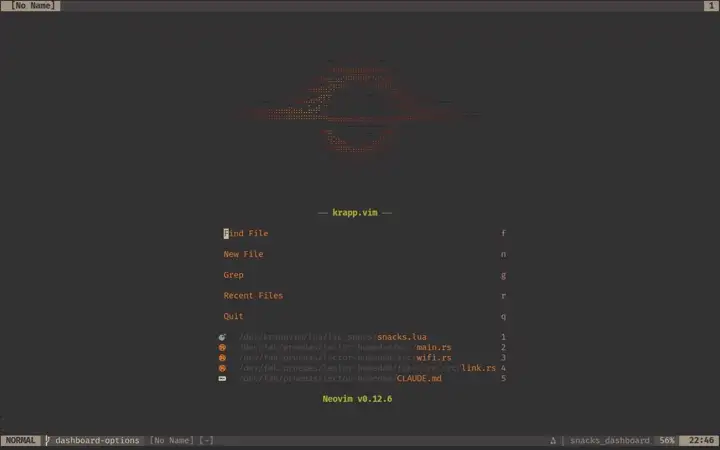

## Elegir un dashboard

El paquete del flake tiene una función `.wrap` que arma kvim de nuevo con
tus opciones. En NixOS:

```nix
# flake.nix de tu sistema, con krappvim como input
environment.systemPackages = [
  (krappvim.packages.${system}.default.wrap {
    settings.dashboard.preset = "pokemon";
  })
];
```

Con Home Manager es lo mismo, en `home.packages`.

También podés importar el módulo del flake, que instala kvim y recibe las
mismas opciones. Sirve igual en NixOS (`krappvim.nixosModules.default`) y en
Home Manager (`krappvim.homeModules.default`):

```nix
imports = [ krappvim.nixosModules.default ];
wrappers.neovim = {
  enable = true;
  settings.dashboard.preset = "pokemon";
};
```

En el resto de esta guía los ejemplos muestran solo el `settings.dashboard`
que va adentro del `.wrap`.

Sin configuración, kvim usa el preset `blackhole`: el splash animado de
milli, el título, cinco teclas, los archivos recientes y la versión de
Neovim.

## Presets

Un preset solo pone valores por defecto. Todo lo que escribas al lado gana,
así que podés partir de un preset y cambiar una pieza:

```nix
settings.dashboard = {
  preset = "doom";
  header.figlet.font = "banner";
};
```

| Preset | Cómo se ve | Qué tiene |
| --- | --- | --- |
| `blackhole` |  | Splash de milli, título, teclas, recientes. Es el default. |
| `doom` | 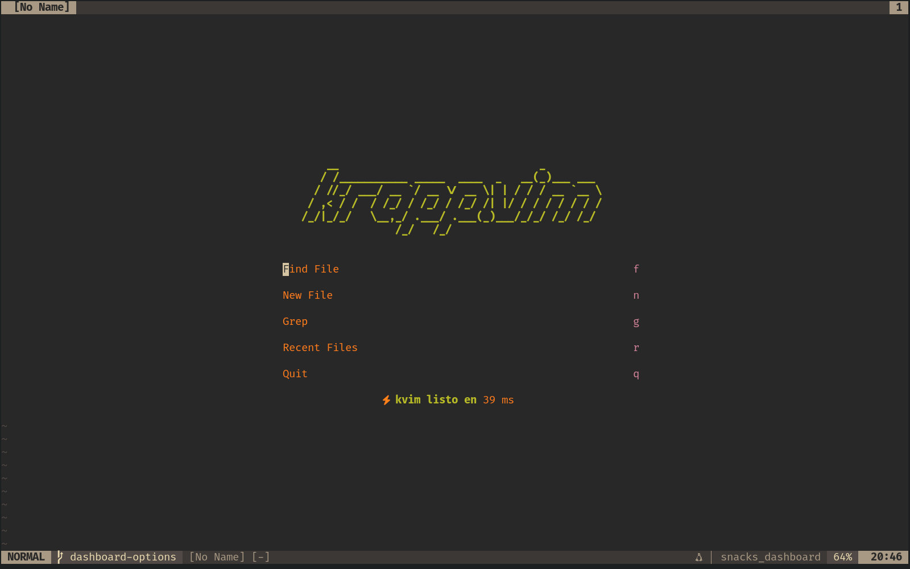 | Texto grande con figlet y el tiempo de arranque. |
| `pokemon` | 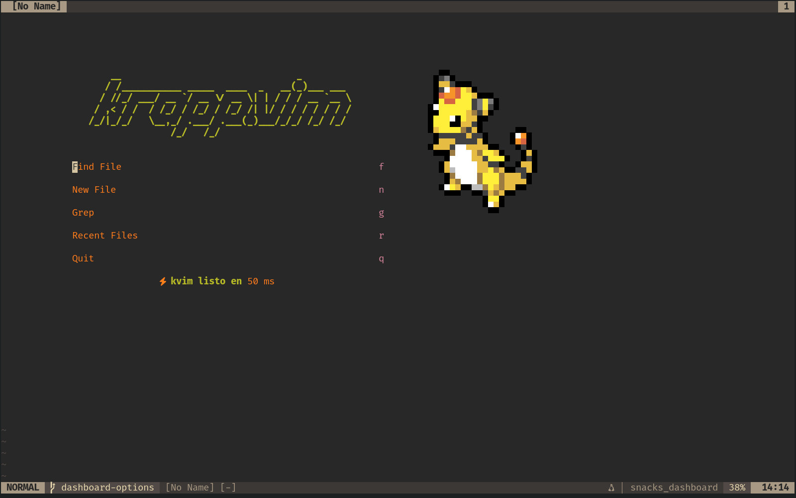 | Figlet y un pokémon al costado que cambia entre arranques. |
| `chafa` | 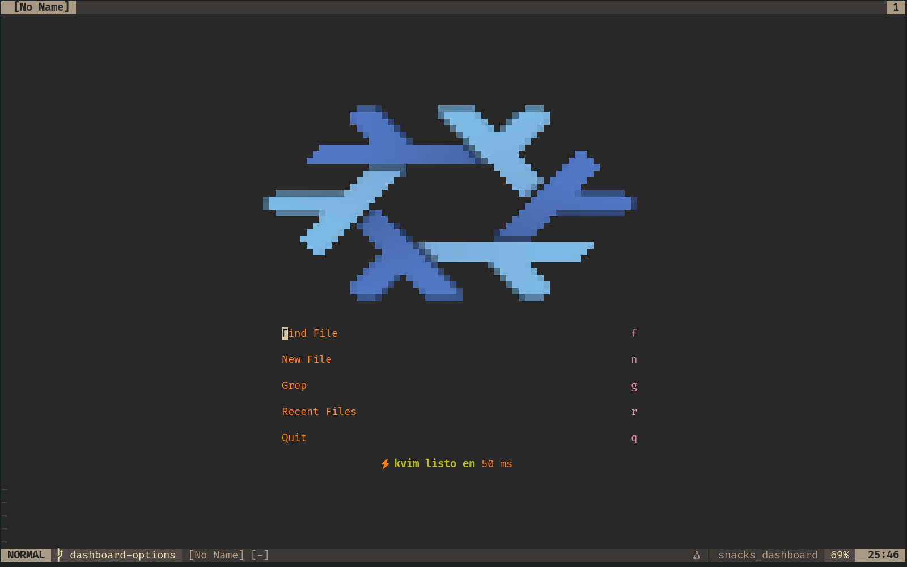 | Una imagen convertida en caracteres. |
| `startify` | 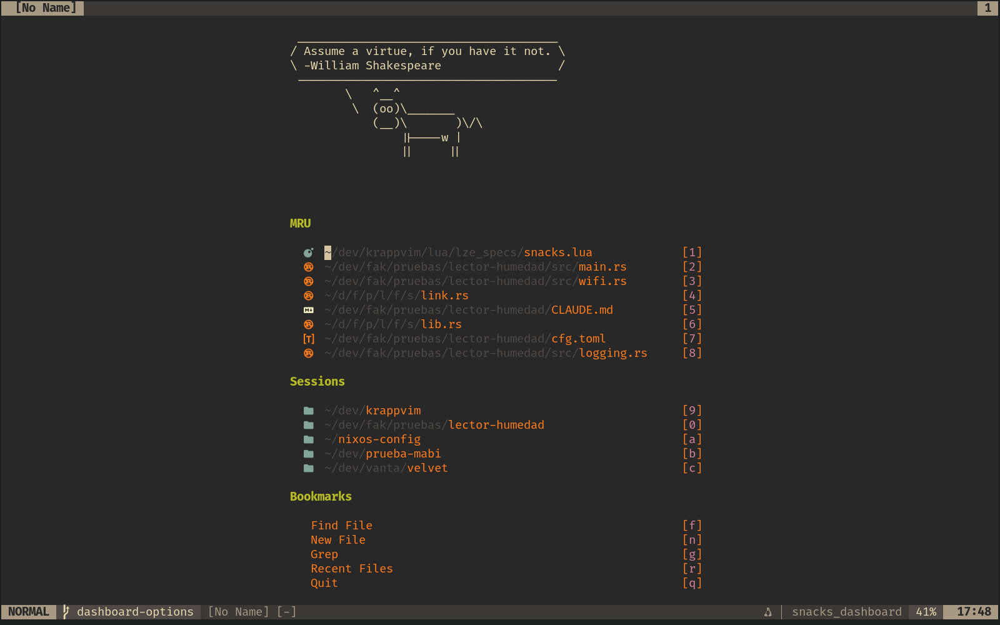 | Frase de fortune con cowsay, recientes y proyectos en lista. |
| `advanced` | 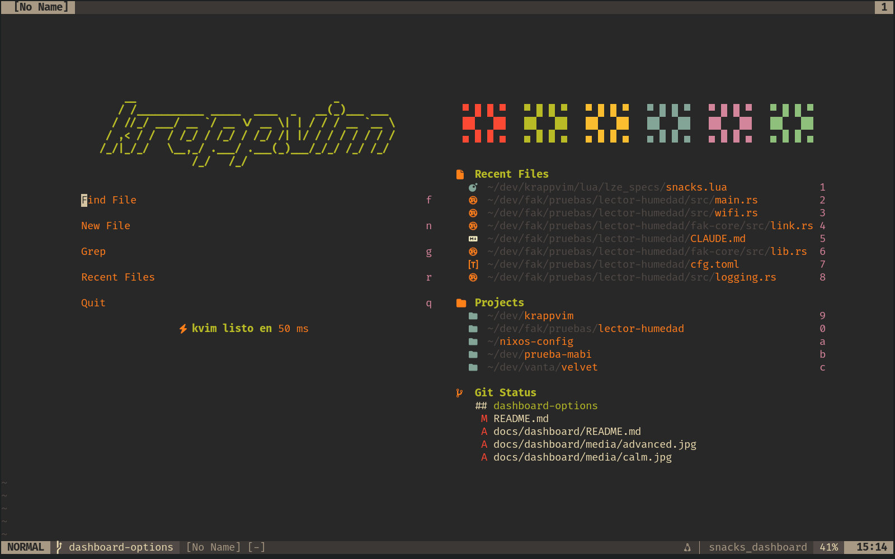 | Dos columnas: colores, recientes, proyectos y estado de git. |
| `github` | 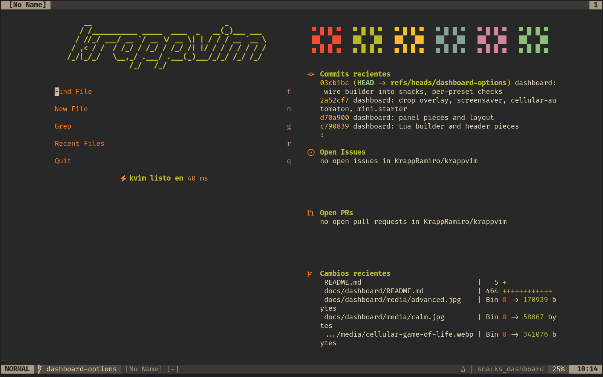 | Commits, issues y PRs del repo (con `gh`). |
| `compact` | 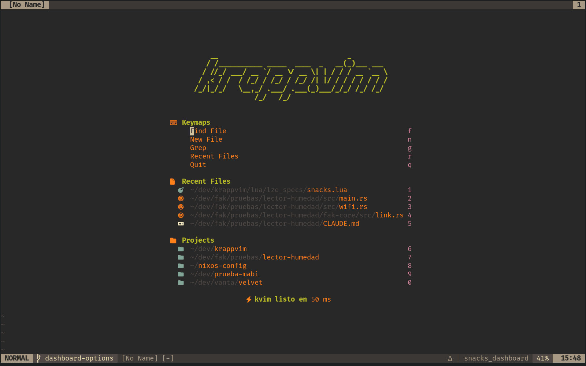 | Teclas, recientes y proyectos en poco espacio. |
| `image` | 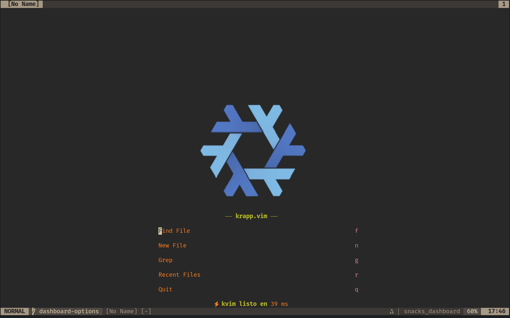 | Una imagen con píxeles reales (protocolo kitty). |
| `fastfetch` | 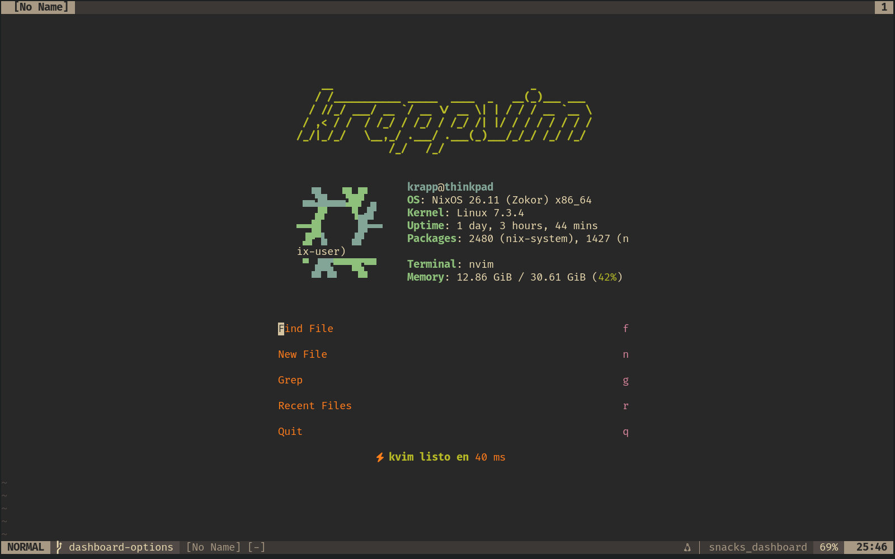 | Datos del sistema debajo del header. |
| `bonsai` | 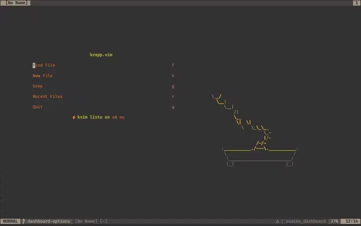 | Un bonsái que crece al costado. |
| `aquarium` | 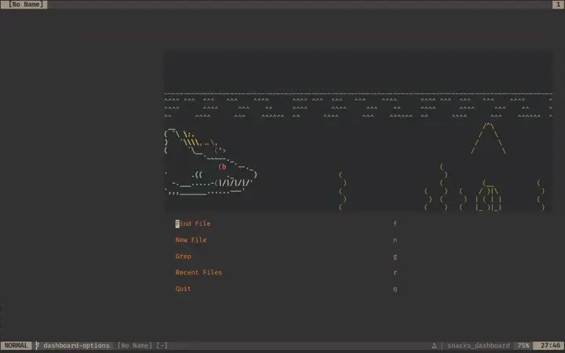 | Un acuario animado. |
| `calm` | 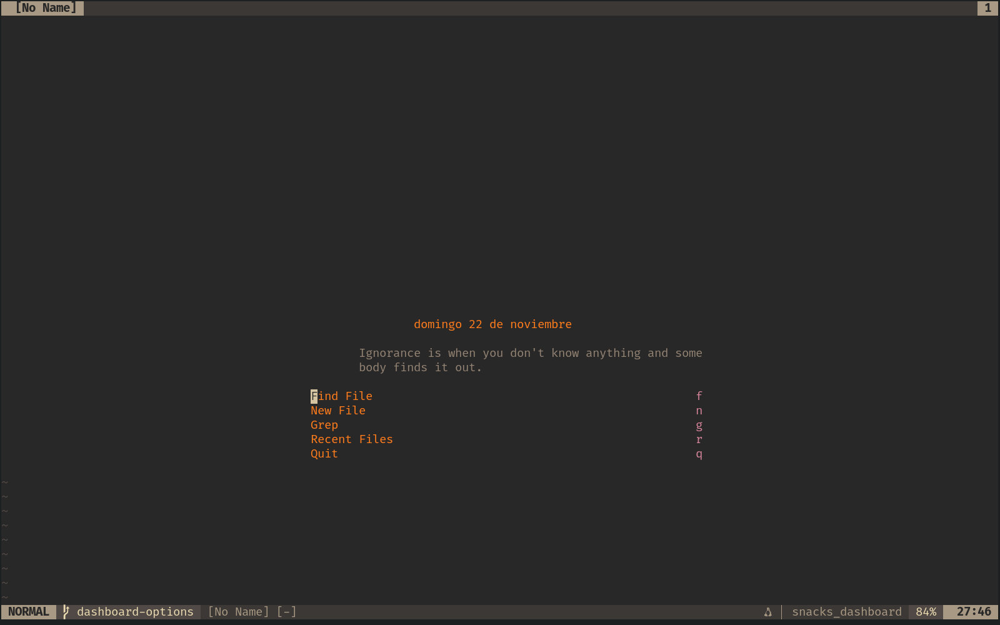 | Fecha, una frase corta y las teclas. Nada se mueve. |
| `ministarter` | 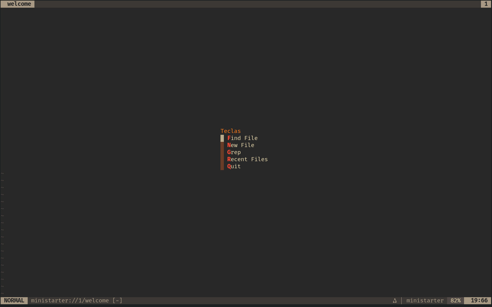 | mini.starter en vez de snacks. |

## Opciones generales

| Opción | Tipo | Default | Para qué |
| --- | --- | --- | --- |
| `preset` | uno de la tabla de arriba | `"blackhole"` | Punto de partida. |
| `style` | `default`, `startify`, `compact`, `calm` | `"default"` | Cómo se dibujan las teclas y las listas. |
| `title` | texto o `null` | `"── krapp.vim ──"` | Título debajo del header. `null` lo saca. |
| `keys` | lista de `{ key; desc; action; }` | f, n, g, r, q | Teclas. `[ ]` las saca. |
| `recent.enable` | bool | `true` | Archivos recientes. |
| `recent.limit` | número o `null` | `null` | Cantidad. |
| `recent.cwd` | bool | `false` | Solo los del directorio actual. |
| `projects.enable` | bool | `false` | Proyectos recientes. |
| `projects.limit` | número o `null` | `null` | Cantidad. |
| `layout` | `auto`, `one`, `two` | `"auto"` | Una o dos columnas. |
| `footer.startup` | bool | `false` | Línea "kvim listo en N ms". |
| `footer.version` | bool | `true` | Versión de Neovim. |
| `footer.text` | texto o `null` | `null` | Texto propio al pie. |
| `extraSections` | lista de secciones de snacks | `[ ]` | Secciones crudas, para lo que las piezas no cubren. |

Con `layout = "auto"`, kvim usa dos columnas solo si hay paneles y la
terminal tiene 130 columnas o más. En una terminal más angosta los paneles
van debajo.

Teclas propias:

```nix
settings.dashboard.keys = [
  { key = "f"; desc = "Buscar archivo"; action = ":lua Snacks.picker.smart()"; }
  { key = "c"; desc = "Config"; action = ":e ~/nixos-config/flake.nix"; }
  { key = "q"; desc = "Salir"; action = ":qa"; }
];
```

## Header

El header es la pieza de arriba. Se elige con `header.kind`, y los
parámetros de cada tipo van en un atributo con su nombre
(`header.figlet.font`). Si cambiás de tipo, los parámetros del anterior se
ignoran.

### milli: splash animado

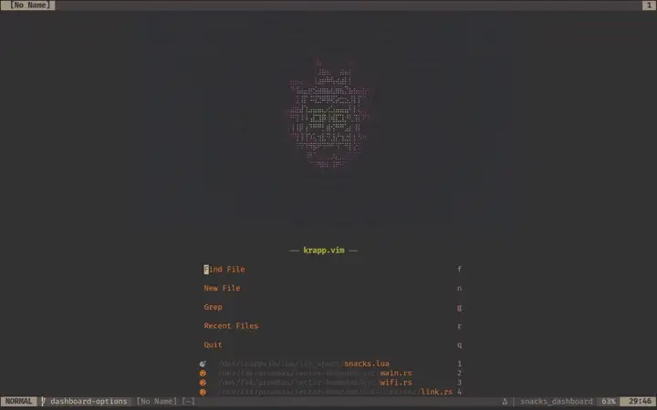

```nix
settings.dashboard.header = {
  kind = "milli";
  milli.splash = "aurora";
};
```

| Parámetro | Tipo | Default | |
| --- | --- | --- | --- |
| `splash` | texto | `"blackhole"` | Un splash incluido en milli, uno del registro o `"random"`. |
| `loop` | bool | `true` | Repetir la animación. |
| `splashFile` | ruta o `null` | `null` | Archivo `.lua` propio (ver [Splash propio](#splash-propio)). |

Agrega: milli.nvim. Los splashes del registro vienen del input
`milli-splashes` del flake, así que no se descarga nada al arrancar. Con
`"random"` se copian los 32 splashes del registro (unos 50 MB); con un
nombre fijo, solo ese. Un nombre que no existe falla al evaluar y muestra
la lista de los que hay.

Otros splashes: 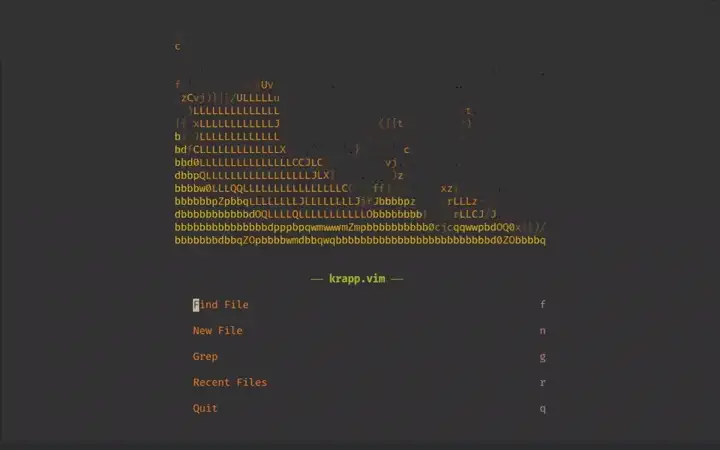
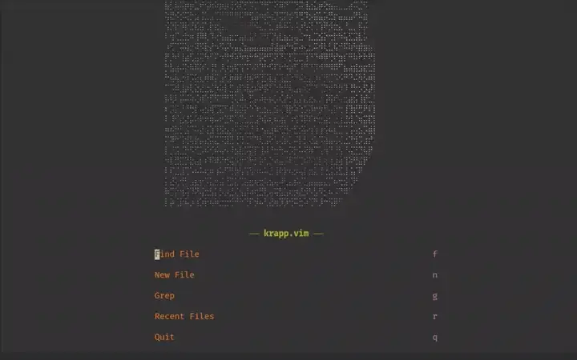 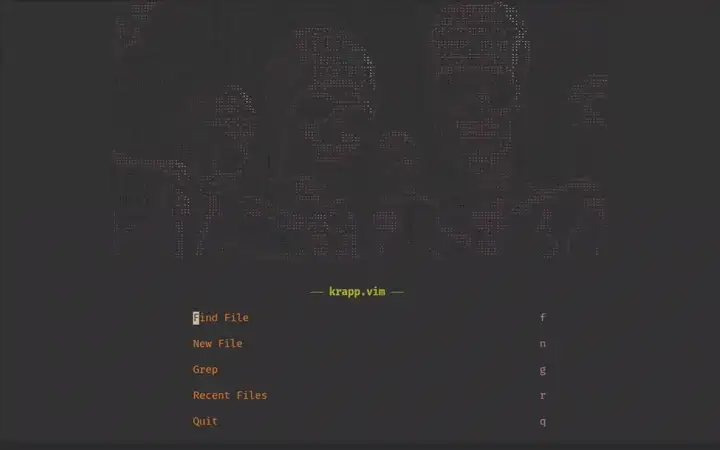

### shader: efecto animado de milli

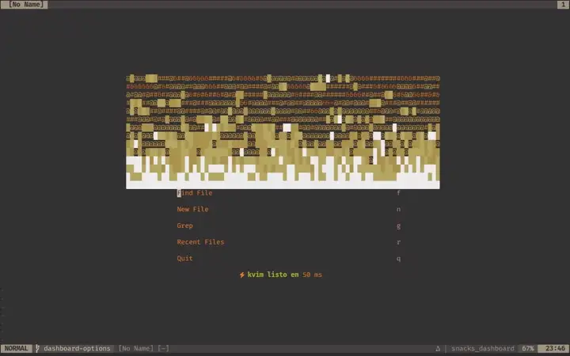

```nix
settings.dashboard.header = {
  kind = "shader";
  shader.name = "plasma";
};
```

| Parámetro | Tipo | Default | |
| --- | --- | --- | --- |
| `name` | `rain`, `plasma`, `doomfire`, `starfield` | `"doomfire"` | Shader. |
| `fps` | número | `30` | Cuadros por segundo. |
| `height` | número | `14` | Alto, en líneas. |

Agrega: milli.nvim. Costo: redibuja 30 veces por segundo mientras el
dashboard está abierto.

Otros shaders: 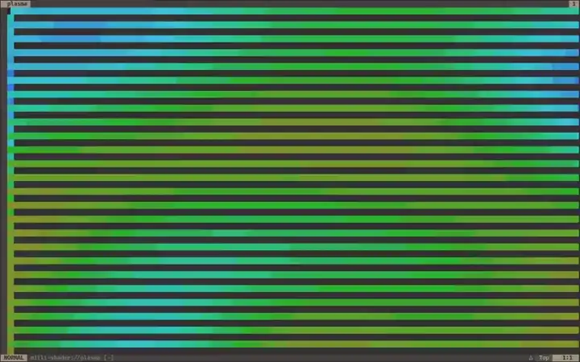
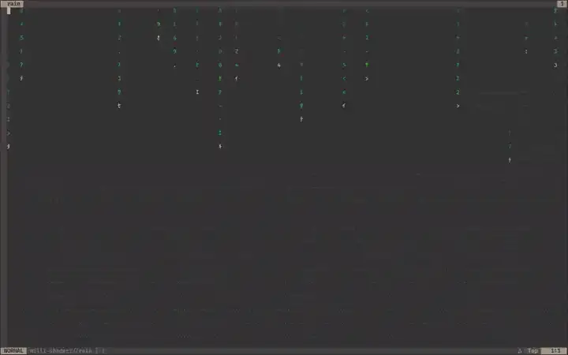 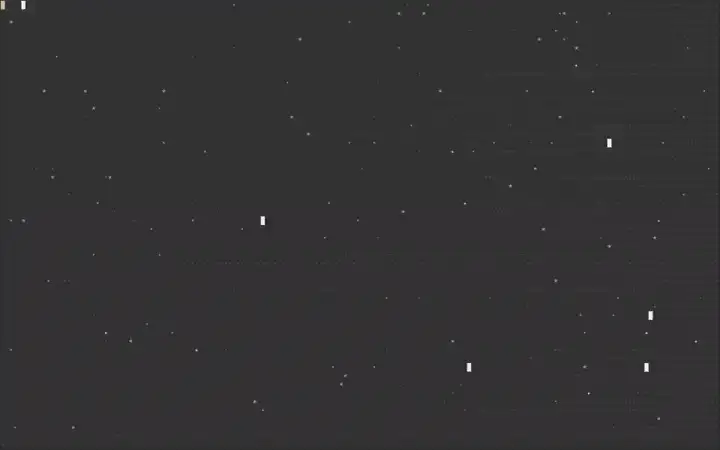

### text: arte fijo

```nix
settings.dashboard.header = {
  kind = "text";
  text.text = "krapp.vim";
};
```

| Parámetro | Tipo | Default | |
| --- | --- | --- | --- |
| `text` | texto | `"krapp.vim"` | Arte ASCII, tal cual. |

Agrega: nada. No corre ningún programa.

### figlet: texto grande


```nix
settings.dashboard.header = {
  kind = "figlet";
  figlet = { text = "hola"; font = "banner"; };
};
```

| Parámetro | Tipo | Default | |
| --- | --- | --- | --- |
| `text` | texto | `"krapp.vim"` | Texto. |
| `font` | texto | `"slant"` | Fuente de figlet. |

Agrega: figlet. Corre una vez y snacks guarda la salida una hora.

### toilet: texto grande con color

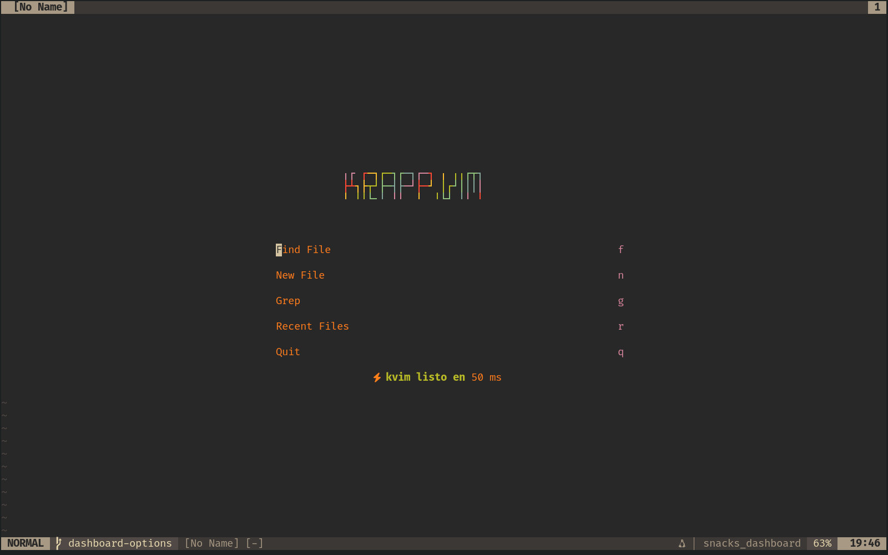

```nix
settings.dashboard.header = {
  kind = "toilet";
  toilet = { font = "future"; filter = "metal"; };
};
```

| Parámetro | Tipo | Default | |
| --- | --- | --- | --- |
| `text` | texto | `"krapp.vim"` | Texto. |
| `font` | texto | `"future"` | Fuente de toilet. |
| `filter` | texto o `null` | `"gay"` | Filtro de color (`gay`, `metal`, `border` y otros). |
| `height` | número | `4` | Alto, en líneas. |
| `indent` | número | `14` | Margen a la izquierda, para centrarlo. |

Agrega: toilet.

### hour: saludo según la hora

| Noche | Mañana |
| --- | --- |
| 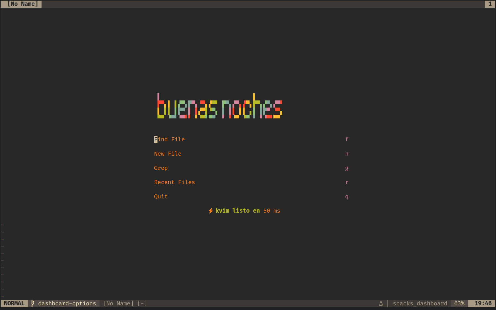 | 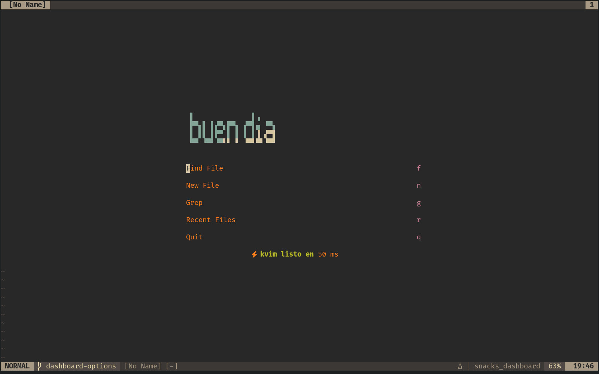 |

```nix
settings.dashboard.header = {
  kind = "hour";
  hour.morning = "toilet -f smblock --metal 'a laburar'";
};
```

| Parámetro | Tipo | Default | |
| --- | --- | --- | --- |
| `night` | comando | `toilet -f smblock --gay 'buenas noches'` | Antes de las 6. |
| `morning` | comando | `toilet -f smblock --metal 'buen dia'` | De 6 a 13. |
| `afternoon` | comando | `toilet -f smblock -F border 'buenas tardes'` | Desde las 13. |
| `height` | número | `4` | Alto, en líneas. |
| `indent` | número | `4` | Margen a la izquierda. |

Agrega: toilet.

### image: imagen real


```nix
settings.dashboard.header = {
  kind = "image";
  image = { path = ./avatar.png; width = 30; height = 12; };
};
```

| Parámetro | Tipo | Default | |
| --- | --- | --- | --- |
| `path` | ruta | el copo de NixOS | Imagen. |
| `width` | número | `30` | Ancho, en columnas. |
| `height` | número | `15` | Alto, en líneas. |

Agrega: nada (usa `Snacks.image`). Necesita una terminal con el protocolo
de imágenes de kitty, como ghostty, kitty o WezTerm. En otras terminales el
espacio queda vacío.

### chafa: imagen en caracteres


```nix
settings.dashboard.header = {
  kind = "chafa";
  chafa = { path = ./avatar.png; symbols = "braille"; };
};
```

| Parámetro | Tipo | Default | |
| --- | --- | --- | --- |
| `path` | ruta | el copo de NixOS | Imagen. |
| `width` | número | `60` | Ancho, en columnas. |
| `height` | número | `17` | Alto, en líneas. |
| `symbols` | texto | `"vhalf"` | Símbolos de chafa (`vhalf`, `block`, `braille` y otros). |

Agrega: chafa. Funciona en cualquier terminal con color.

### cmd: cualquier comando


```nix
settings.dashboard.header = {
  kind = "cmd";
  cmd = {
    cmd = "fortune -s | cowsay";
    height = 12;
    packages = [ pkgs.fortune pkgs.cowsay ];
  };
};
```

| Parámetro | Tipo | Default | |
| --- | --- | --- | --- |
| `cmd` | comando | `""` | Su salida se dibuja en el dashboard. |
| `height` | número | `10` | Alto, en líneas. |
| `width` | número o `null` | `null` | Ancho (`null`: el del dashboard). |
| `ttl` | segundos | `3600` | Cuánto guarda snacks la salida. |
| `random` | número o `null` | `null` | Con N, snacks rota entre N salidas guardadas. |
| `animated` | bool | `false` | Programa que se anima: no se guarda y queda corriendo. |
| `title` | texto o `null` | `null` | Título encima. |
| `indent` | número | `0` | Margen a la izquierda. |
| `packages` | lista de paquetes | `[ ]` | Programas que el comando necesita en el `PATH`. |

### none

`header.kind = "none"` no dibuja nada arriba.

## Paneles

`panel` es una lista de piezas que van al costado (con `layout = "two"`) o
debajo. Cada elemento es un nombre, o un attrset con `kind` y parámetros:

```nix
settings.dashboard = {
  layout = "two";
  panel = [
    "colorscript"
    { kind = "pokemon"; pokemon.random = 20; }
  ];
};
```

Con dos columnas, el dashboard necesita unas 130 columnas de terminal.

| Panel | Parámetros (default) | Agrega |
| --- | --- | --- |
| `pokemon`  | `random` (10), `height` (30) | pokemon-colorscripts |
| `krabby` | `random` (10), `height` (30) | krabby |
| `fastfetch`  | `modules` (`"Title:OS:Kernel:Uptime:Packages:Terminal:Memory"`), `logo` (`"nixos_small"`), `height` (10) | fastfetch |
| `github`  | `sections` (commits, issues, prs, diff), `limit` (3) | gh, git |
| `git` | `height` (5) | git |
| `colorscript` | `name` (`"square"`), `height` (5) | dwt1-shell-color-scripts |
| `fortune`  | `cow` (true), `short` (true), `height` (10) | fortune, cowsay |
| `cbonsai`  | `live` (true), `height` (22) | cbonsai |
| `aquarium`  | `height` (20), `width` (100) | asciiquarium |
| `cmatrix` 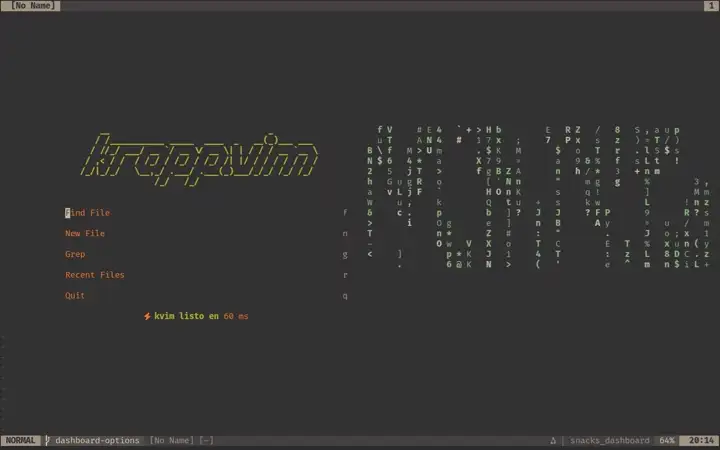 | `height` (14), `width` (70), `color` (`"cyan"`) | cmatrix |
| `lolcat` 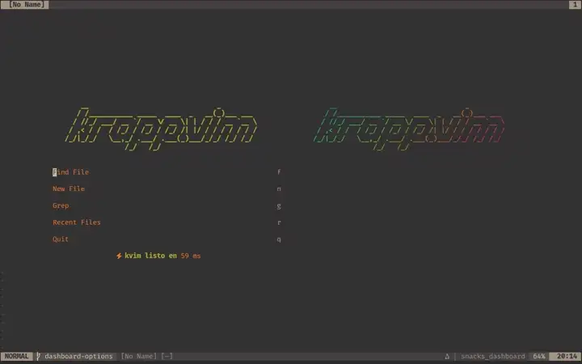 | `text` (`"krapp.vim"`), `font` (`"slant"`), `height` (7) | figlet, lolcat |
| `recent` | `limit` (8) | nada |
| `projects` | `limit` (5) | nada |
| `cmd` | los mismos que el header `cmd` | lo que pongas en `packages` |

El panel `github` solo aparece si abrís kvim dentro de un repo de git, y
necesita `gh auth login`.

Los paneles animados (`cbonsai` con `live`, `aquarium`, `cmatrix`) quedan
corriendo mientras el dashboard está abierto.

## Overlay: drop.nvim

Cosas que caen por encima del dashboard: hojas, nieve, estrellas y unos 60
temas más.

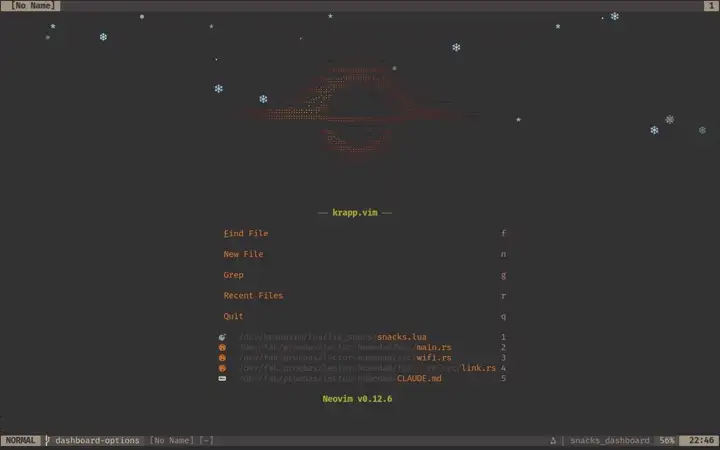

```nix
settings.dashboard.overlay.drop = {
  enable = true;
  theme = "snow";
};
```

| Parámetro | Tipo | Default | |
| --- | --- | --- | --- |
| `enable` | bool | `false` | Prenderlo. |
| `theme` | texto | `"auto"` | Tema. `auto` elige según la fecha. |
| `screensaver` | bool o segundos | `false` | Segundos sin tocar nada para que drop tape la pantalla. |

Agrega: drop.nvim. Otros temas: 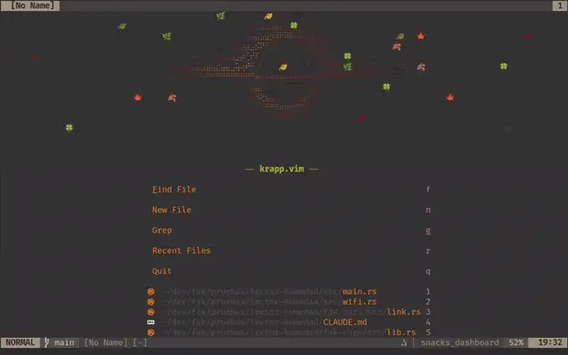
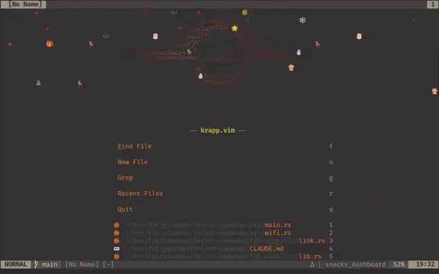

## Extras

### Protector de pantalla de milli

Después de un rato sin tocar nada, milli tapa la pantalla con un shader o
un splash. Funciona en cualquier buffer, no solo en el dashboard.

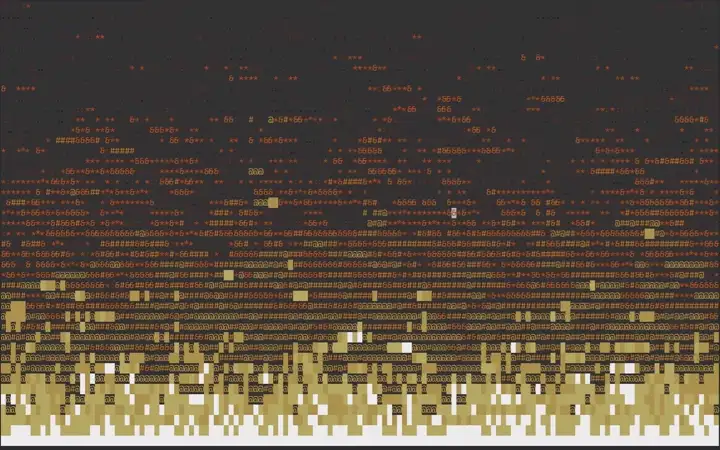

```nix
settings.dashboard.extras.screensaver = {
  enable = true;
  shader = "rain";
  after = 600;
};
```

| Parámetro | Tipo | Default | |
| --- | --- | --- | --- |
| `enable` | bool | `false` | Prenderlo. |
| `shader` | texto o `null` | `"doomfire"` | Shader a mostrar. |
| `splash` | texto o `null` | `null` | Splash en vez de shader. |
| `after` | segundos | `300` | Inactividad antes de aparecer. |

Agrega: milli.nvim.

### cellular-automaton

Una tecla de broma que derrite el buffer actual.

| make_it_rain | game_of_life |
| --- | --- |
| 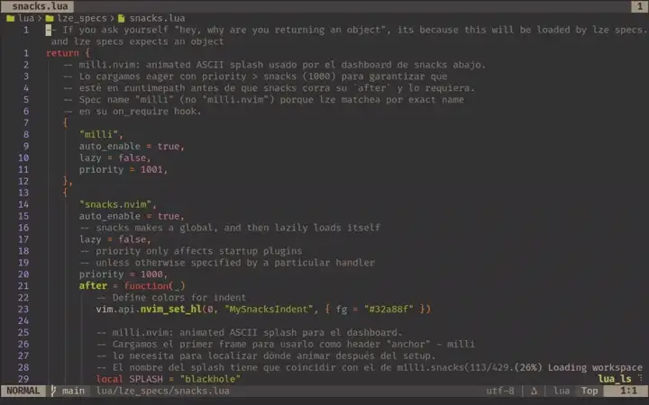 | 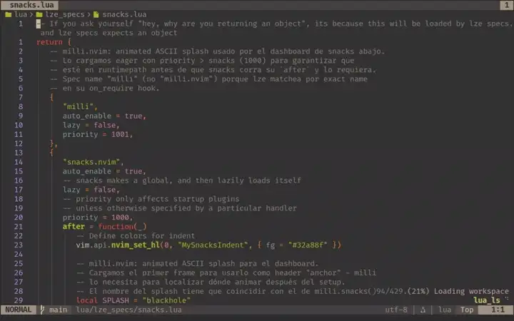 |

```nix
settings.dashboard.extras.cellularAutomaton = {
  enable = true;
  keymap = "<leader>ur";
};
```

Agrega: cellular-automaton.nvim, que se carga recién al apretar la tecla.

## Splash propio

milli tiene una CLI que convierte un GIF, un video o una imagen en un
splash. No está empaquetada en este flake: correla a mano y pasá el archivo
que genera.

1. Generá el splash con la CLI de milli. Las instrucciones están en el
   README de [milli.nvim](https://github.com/Amansingh-afk/milli.nvim). El
   resultado es un archivo `.lua`.
1. Guardalo al lado de tu config de Nix, por ejemplo `./mi-splash.lua`.
1. Pasalo con `splashFile`:

   ```nix
   settings.dashboard.header = {
     kind = "milli";
     milli.splashFile = ./mi-splash.lua;
   };
   ```

## Problemas conocidos

- **`section = "startup"` de snacks no funciona en kvim.** Llama a
  `require("lazy.stats")`, y kvim usa lze en vez de lazy.nvim. Para el
  tiempo de arranque usá `footer.startup = true`.
- **Un `cmd` animado propio se congela.** El programa terminó y snacks
  guardó el último cuadro. Poné `animated = true`: kvim no lo guarda y le
  agrega `; sleep 600` para que siga vivo. (Neovim marca cada terminal que
  termina con `[Process exited 0]`; en el dashboard kvim lo borra.)
- **Los paneles quedan debajo y no al costado.** La terminal tiene menos de
  130 columnas. Agrandala o usá `layout = "one"`.
- **Un panel tapa el header.** Con los paneles debajo, el dashboard puede
  quedar más alto que la ventana, y snacks dibuja los paneles que no
  entran pegados arriba. Agrandá la terminal o bajale el `height` al panel
  (por ejemplo, `pokemon.height = 20`).
- **cbonsai dibuja caracteres raros.** Necesita `LC_ALL=C`; el panel
  `cbonsai` ya lo pone. En un `cmd` propio, agregalo vos.
- **La imagen no aparece.** La terminal no soporta el protocolo de kitty.
  Usá `chafa` en su lugar.

## Grabar los medios de esta guía

`scripts/record-dashboards.sh` arma kvim con cada configuración, lo abre en
ghostty dentro de un sway headless y guarda capturas y animaciones en
`docs/dashboard/media/`. Ver el comentario al principio del script.
